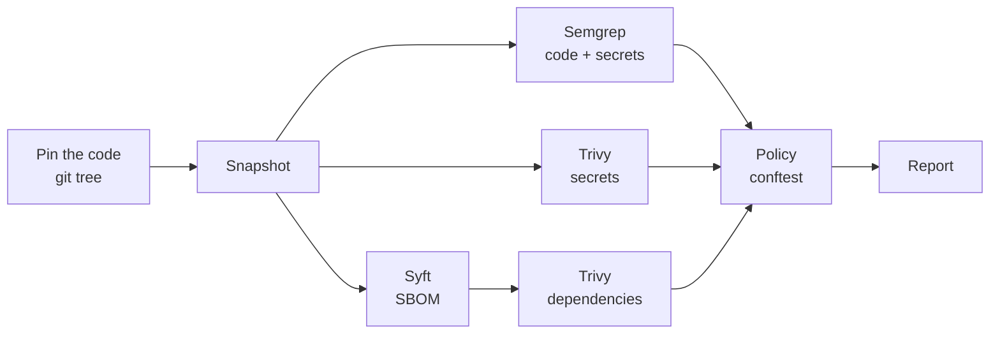

# How it works

devsec orchestrates established scanners. It does not scan code itself.
{: .fs-5 .fw-300 }

## Pipeline

1. **Pin the code.** The working tree (tracked and untracked files, minus those git
   ignores) is recorded as a git tree, without touching your staging area. `--ref`
   scans a commit instead.
2. **Snapshot.** git checks that tree out into `.devsec/snapshots/`. Scanners read the
   snapshot, so the result belongs to one exact version of the code, even if files
   change during the scan.
3. **Scan in parallel.** Semgrep (code and secret rules, one process) and Trivy (secrets)
   read the snapshot. Syft produces an SBOM, which Trivy checks for vulnerable
   dependencies, so the source is not read twice.
4. **Policy.** Findings are evaluated with conftest. Each gets a verdict: deny, warn or
   dropped.
5. **Report.** Only flagged findings are returned, in JSON or the scanners' own SARIF.

## Principles

**The scanners decide what is found.** devsec runs each tool from the snapshot root,
as you would in the repository, so the project's own scanner configuration applies.
It adds no rules, filters no files and does not merge or rewrite findings. Each finding
links to the scanner's original output.

One flag is added: Semgrep's `--no-git-ignore`, because the snapshot sits in an
ignored folder. The snapshot already contains only the files git does not ignore.

**Results are reproducible.** Each run records the tree, the exact commands and the
tool versions. The project's test suite checks that devsec's results equal running each
tool directly.

## Caching

A scan is reused only when everything that affects it is identical: the code (tree),
the configuration, the tool versions and the vulnerability database version. Semgrep's
registry rules change without a version number, so cached scans also expire after 24
hours (`cacheTtlHours`).

The policy is always evaluated again, so policy changes apply immediately.

## Tools

| Tool | Role | Licence |
|------|------|---------|
| [Semgrep CE](https://semgrep.dev) | Static analysis and secret rules | LGPL-2.1 |
| [Trivy](https://trivy.dev) | Secrets and dependency vulnerabilities | Apache-2.0 |
| [Syft](https://github.com/anchore/syft) | SBOM (CycloneDX and SPDX) | Apache-2.0 |
| [conftest](https://www.conftest.dev) | Policy evaluation (Open Policy Agent) | Apache-2.0 |
